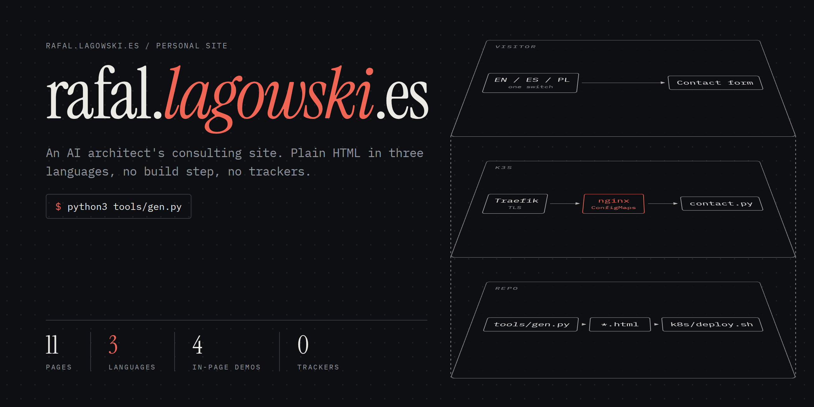
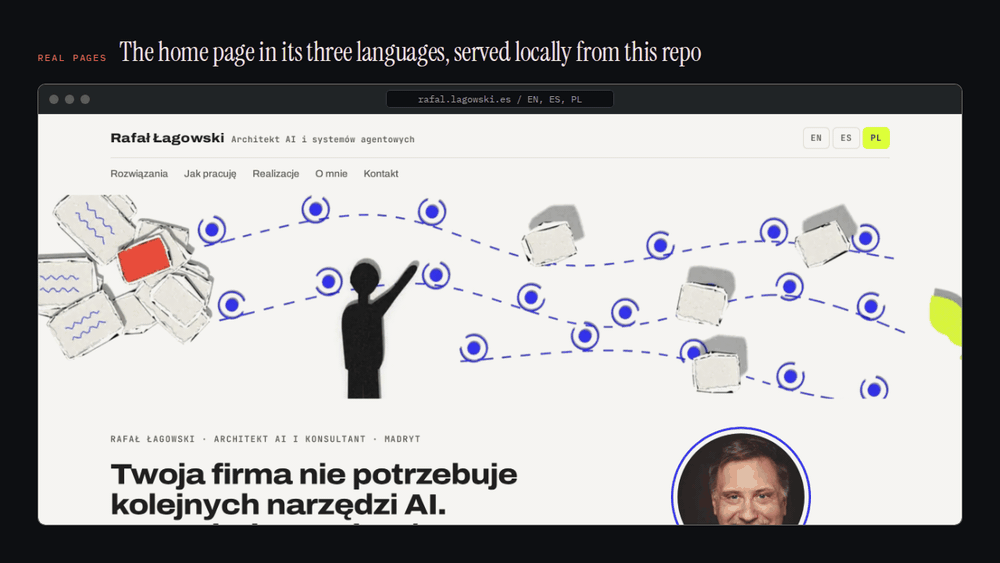
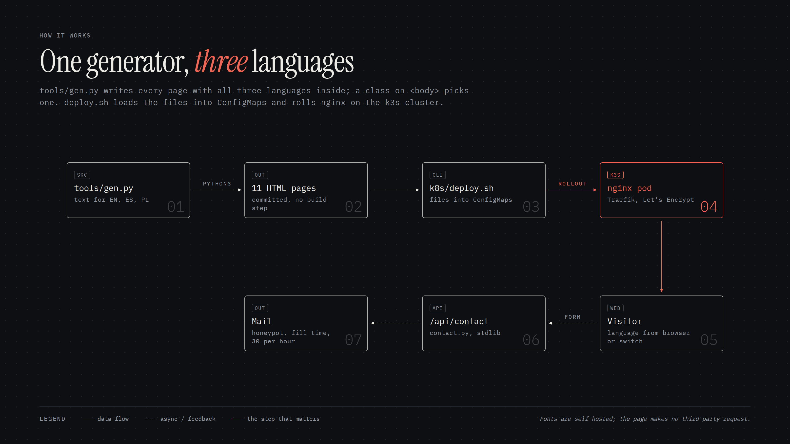

<a href="https://rafal.lagowski.es"><picture>
  <source media="(prefers-color-scheme: light)" srcset="docs/images/banner-light.png">
  
</picture></a>

<b>An AI architect's consulting site. Plain HTML in three languages, no build step, no trackers.</b> 
<a href="#editing">Install</a> · <a href="#demo">Demo</a> · <a href="#how-it-works">How it works</a> · <a href="https://rafal.lagowski.es">Site</a>

  
  
  
  

# rafal.lagowski.es

Personal expert profile of Rafał Łagowski, AI & Agentic Systems Architect.
Plain static HTML, CSS and vanilla JS, served by nginx on the k3s cluster
(namespace `rafal-site`, Traefik ingress, Let's Encrypt via cert-manager). No build step, no framework, no trackers. Fonts (Archivo, JetBrains Mono; SIL OFL 1.1) are self-hosted; fonts and colours follow labs.lagowski.es.

Languages: EN (default), ES, PL. The switch sets a class on `<body>` and stores
the choice in `localStorage` under `lagowski-lang`; first visits follow the
browser language when it is Spanish or Polish.

## Demo

Real pages: the home page served locally from this repo (`python3 -m http.server`), once per language.

## How it works

`tools/gen.py` writes every page with the three languages inside; a class on `<body>` picks one. `k8s/deploy.sh`
loads the files into ConfigMaps and rolls the nginx pod behind Traefik. The contact form posts to `k8s/contact.py`,
which mails the message on (honeypot, minimum fill time, 30 messages an hour).

## Deploying

    k8s/deploy.sh            # kube context defaults to k3s-remote

The script loads the files into ConfigMaps and rolls the nginx pod.
DNS: `rafal.lagowski.es` A record -> the cluster IP.

## Editing

The pages are generated from `tools/gen.py` so the three languages stay in one
place, and the generated HTML is committed:

    python3 tools/gen.py
    python3 -m http.server 8765    # preview at http://localhost:8765

Values still to fill in sit at the top of `tools/gen.py`: `DAY_RATE`,
`LINKEDIN`, `VIDEO`. Rerun the script after any change.

## Contact form

No email address is published. The form posts to `/api/contact`, served by
`k8s/contact.py` (stdlib Python, honeypot + minimum fill time + an hourly cap of 30 messages),
which mails the message to rafal@lagowski.es through Google SMTP with the
visitor in Reply-To. The CV is not published; it is sent on request (topic
"CV request"). Credentials live in the Secret `rafal-site-smtp`
(keys `SMTP_USER`, `SMTP_PASS` = a Google app password), created by hand:

    read -s P; kubectl -n rafal-site create secret generic rafal-site-smtp \
      --from-literal=SMTP_USER=rafal@lagowski.es --from-literal=SMTP_PASS="$P"; unset P
    kubectl -n rafal-site rollout restart deploy/rafal-contact

`tools/og.html` is the source of `assets/og.png` (1200x630 social card) and
`tools/icon.html` of the touch icon; both are rendered with headless Chrome.

The art in `assets/art/` is the paper-picture set from labs.lagowski.es (one at random per load).

The interactive demos and the starter-pack / workshop PDFs come from the
lagowski.es services site, which stays a separate project.
